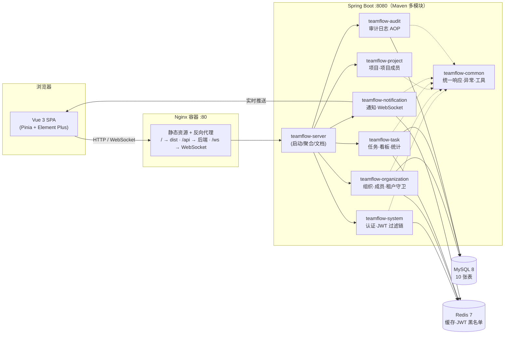
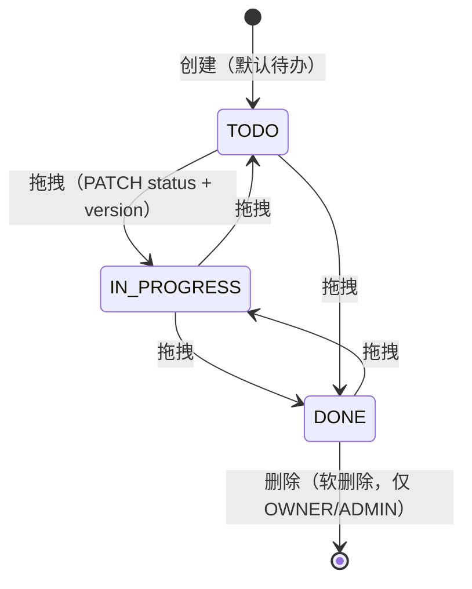

# TeamFlow — 多租户团队协作平台

      

**TeamFlow** 是一个开箱即用的团队协作平台：以「组织 → 项目 → 任务」为主线，提供看板拖拽、实时通知、数据统计、审计日志等能力，内置多租户数据隔离与三级角色权限控制。

- **P0 核心**：注册登录（JWT）、组织与成员管理、项目与任务全生命周期、看板、项目成员协作
- **P1 增强**：Redis 多级缓存、审计日志 + 任务操作历史、数据统计、WebSocket 实时通知、在线接口文档、容器化一键部署

---

## ✨ 功能特性

### 核心业务

| 模块 | 能力 | 说明 |
|---|---|---|
| 🔐 认证 | 注册 / 登录 / 登出 / 我的信息 | JWT（HS256，24h）+ Redis 黑名单；登录失败防枚举 |
| 🏢 组织 | 创建 / 编辑 / 删除 / 成员管理 | OWNER / ADMIN / MEMBER 三级角色；成员搜索（邮箱脱敏）；移除成员级联清理 |
| 📁 项目 | CRUD / 归档 / 恢复 / 项目成员 | 名称组织内唯一（含已归档占用）；MEMBER 仅可见「我参与的」 |
| ✅ 任务 | 创建 / 编辑 / 筛选排序分页 / 删除 | 负责人限项目成员；归档项目禁写；软删除 |
| 🎯 看板 | 三列拖拽流转 | 乐观锁（version）并发保护，冲突 409 自动回滚刷新 |
| 🔔 通知 | 站内信 + 实时推送 | 任务分配 / 状态变更 / 项目成员 / 组织成员四类事件；操作人自动排除 |

### P1 增强

| 能力 | 说明 |
|---|---|
| ⚡ Redis 缓存 | 组织信息 / 成员角色 / 项目列表 / 统计缓存；写后删失效 + 空值防穿透，**角色降级、移除成员立即生效** |
| 📜 审计与历史 | `@AuditLog` 注解 AOP 落库（16 类动作）；任务操作历史内嵌任务详情时间线；审计页（OWNER/ADMIN，动作 / 操作人 / 时间筛选） |
| 📊 数据统计 | 项目 / 组织两级统计（完成率向下取整、逾期=未完成且超期），与 SQL 对账一致 |
| 📡 实时通知 | WebSocket 握手鉴权（`/ws/notifications?token=`），推送驱动前端铃铛未读数实时变化 |
| 📖 接口文档 | SpringDoc + Knife4j 全接口注解化，分组浏览、在线调试 |
| 🐳 容器化 | backend / frontend 多阶段镜像 + docker compose 一键拉起全栈 |

---

## 🏗️ 系统架构



> 关键机制：所有写操作经过 **TenantGuard 租户守卫**（组织归属 + 角色校验，跨租户访问一律 40301/40302）；任务写操作与操作历史、审计日志**同事务**落库，不丢记录。

### 任务状态流转（看板）



- 提交携带 `version` 乐观锁：并发拖拽时后提交方返回 **40901**，前端以服务端数据回滚卡片
- 状态变更实时通知「创建人 + 当前负责人」（自动去重、排除操作人本人）

---

## 🚀 快速开始

### 方式一：Docker 一键部署（推荐）

```bash
git clone <repo-url> teamflow
cd teamflow

# 一键构建并启动 mysql / redis / backend / frontend(nginx)
docker compose -p teamflow-app up -d --build
```

启动完成后（backend 健康检查通过约需 40s）：

| 入口 | 地址 |
|---|---|
| 前端应用 | http://localhost（nginx，占 80 端口） |
| 接口文档 | http://localhost/doc.html |
| 健康检查 | http://localhost/api/ping |

> 首次启动自动执行 `database/schema.sql` 初始化 10 张表；生产部署请通过环境变量覆盖 `JWT_SECRET` 与数据库密码。

### 方式二：本地开发

```bash
# 1. 基础设施（MySQL/Redis 容器）
docker compose -f docker-compose.dev.yml up -d

# 2. 后端（Java 17 + Maven，默认 8080）
mvn -f backend/pom.xml clean package
java -jar backend/teamflow-server/target/teamflow-server-0.1.0-SNAPSHOT.jar

# 3. 前端（Node 18+，默认 5173，/api 与 /ws 自动代理到 8080）
cd frontend
npm install
npm run dev
```

常用环境变量（均有代码默认值，按需覆盖）：`MYSQL_HOST/PORT`、`REDIS_HOST/PORT`、`SERVER_PORT`、`JWT_SECRET`、`FRONTEND_HOST_PORT`。

---

## 🧪 接口测试

内置 PowerShell 全链路测试脚本（正反例 + 越权 + 级联 + SQL 对账）：

```bash
powershell -ExecutionPolicy Bypass -File backend\tests\m1-auth-api.ps1          # 24 用例：认证
powershell -ExecutionPolicy Bypass -File backend\tests\m2-org-api.ps1           # 44 用例：组织与成员
powershell -ExecutionPolicy Bypass -File backend\tests\m3-project-task-api.ps1  # 104 用例：项目与任务
powershell -ExecutionPolicy Bypass -File backend\tests\m5-enhancement-api.ps1   # 75 用例：P1 增强
```

当前全部通过：**24 / 44 / 104 / 75 ✅**（含缓存立即收紧、409 并发回滚、跨租户 403、统计 SQL 对账、通知操作人排除、WebSocket 握手鉴权等关键场景）。

---

## 📁 目录结构

```
TeamFlow
├── backend/                    # Spring Boot 后端（Maven 多模块）
│   ├── teamflow-common/        #   统一响应 Result / 业务码 / 全局异常 / 工具
│   ├── teamflow-system/        #   认证、JWT 过滤链、用户、安全配置
│   ├── teamflow-organization/  #   组织、成员、租户守卫、Redis 角色缓存
│   ├── teamflow-project/       #   项目、项目成员
│   ├── teamflow-task/          #   任务、看板、统计、操作历史
│   ├── teamflow-notification/  #   站内通知、WebSocket 实时推送
│   ├── teamflow-audit/         #   @AuditLog AOP 审计
│   ├── teamflow-server/        #   启动模块（聚合 + Knife4j 文档）
│   ├── tests/                  #   M1/M2/M3/M5 接口测试脚本
│   └── Dockerfile              #   多阶段镜像（Maven 构建 → JRE 运行）
├── frontend/                   # Vue 3 前端
│   ├── src/views/              #   登录/工作台/项目/任务/看板/统计/审计
│   ├── src/stores/             #   组织状态、通知（WS 连接与未读数）
│   ├── nginx.conf              #   SPA 回退 + /api、/ws 反代
│   └── Dockerfile              #   node 构建 → nginx 运行
├── database/schema.sql         # 10 张表建表脚本（容器首启自动执行）
├── docker-compose.yml          # 生产式一键部署
├── docker-compose.dev.yml      # 本地开发基础设施
└── docs/                       # 需求 PRD / 接口 / 数据库 / 技术 / 实施计划
```

---

## 📖 设计文档

| 文档 | 内容 |
|---|---|
| [需求文档-PRD](docs/需求文档-PRD.md) | 产品需求、功能清单（FR 编号）、验收口径 |
| [接口设计文档](docs/接口设计文档.md) | 全接口契约（路径 / 参数 / 响应 / 错误码） |
| [数据库设计文档](docs/数据库设计文档.md) | 10 张表结构、索引、枚举动作码 |
| [技术计划设计书](docs/技术计划设计书.md) | 架构选型、缓存规范、安全设计 |
| [实施计划](docs/实施计划.md) | M0–M6 里程碑拆解与验收标准 |

> 运行中的在线文档：启动后访问 `http://localhost/doc.html`（或后端直连 `:8080/doc.html`），支持按分组浏览与在线调试。

---

## 🔒 安全与多租户

- **认证**：JWT HS256（jti 载荷 + Redis 黑名单登出），未认证统一 `HTTP 401 + code 40101`
- **授权**：组织 OWNER/ADMIN/MEMBER + 项目角色双层校验，越权返回 40302；跨组织访问返回 40301
- **租户隔离**：所有资源访问经 TenantGuard 校验归属链（用户 → 组织 → 项目 → 任务）
- **防枚举**：登录失败统一提示；禁用账号仅凭据正确时提示
- **审计**：关键操作（组织/成员/项目/任务 16 类动作）异步可追溯，MEMBER 不可见审计页
